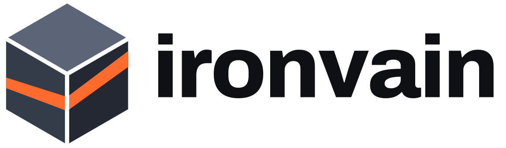

  <a href="https://ironvain.com/en/">
    <picture>
      <source media="(prefers-color-scheme: dark)" srcset="https://raw.githubusercontent.com/ironvain/.github/main/profile/logo-for-dark-mode.svg">
      
    </picture>
  </a>

<strong>Software with a solid core.</strong> Criciúma, SC · Brasil

  <a href="https://ironvain.com/en/">ironvain.com</a> ·
  <a href="mailto:contact@ironvain.com">contact@ironvain.com</a>

---

We build custom software, multi-tenant SaaS and the infrastructure that runs underneath it: from the database to the deploy, observability included.

**What we work with**

`TypeScript` · `Bun / Node.js` · `React` · `React Native` · `PHP / Laravel` · `Go` · `Rust` · `PostgreSQL` · `Redis` · `Docker` · `OpenTelemetry`

**Products**

| Product | What it is | How it was built |
| --- | --- | --- |
| [CalendarNow](https://calendarnow.com.br/) | Multi-tenant online booking platform for service businesses | [Read more](https://ironvain.com/en/products/calendarnow/) |
| [ProfMate](https://profmate.com.br/) | Grading paper exams from photos, with AI and teacher review | [Read more](https://ironvain.com/en/products/profmate/) |
| [Kilomio](https://kilomio.app/) | App that detects trips and shows the real cost per kilometer | [Read more](https://ironvain.com/en/products/kilomio/) |
| [Nitro Atlas](https://nitroatlas.tech/) | Pseudo-3D pixel art racing game, built in Rust | [Read more](https://ironvain.com/en/products/nitro-atlas/) |
| [Pyrite Arena](https://pyritearena.com/) | Multiplayer dynamite arena game, built in Rust | [Read more](https://ironvain.com/en/products/pyrite-arena/) |

---

🇧🇷 Construímos software sob medida, SaaS multi-tenant e a infraestrutura por baixo deles. <a href="https://ironvain.com/">Conheça o site</a> ou escreva para contact@ironvain.com.
 
🇪🇸 Desarrollamos software a medida, SaaS multi-tenant y la infraestructura que corre por debajo. <a href="https://ironvain.com/es/">Visita el sitio</a>.
